# ScholarChart · 学术图表

> 学术规范的矢量图表工具 —— 严谨如期刊，干净如现代设计。

**[🌐 在线使用（无需安装）：https://jyummy.github.io/scholarship/](https://jyummy.github.io/scholarship/)**

为论文与科研场景设计的纯前端图表引擎：**原生 SVG 渲染、矢量 PDF 导出、期刊幅面预设、色盲安全淡雅配色**，零运行时依赖，双击 `index.html` 即用。


## 图表一览

<table>
<tr><td align="center" width="33%">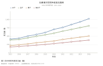<br><sub>图 1 · 先秦诸子研究年度发文趋势</sub></td><td align="center" width="33%">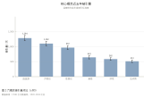<br><sub>图 2 · 核心概念被引量对比（含误差）</sub></td><td align="center" width="33%">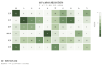<br><sub>图 3 · 诸子 × 核心概念共现矩阵</sub></td></tr>
<tr><td align="center" width="33%">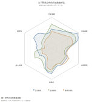<br><sub>图 4 · 研究方向多维对比</sub></td><td align="center" width="33%">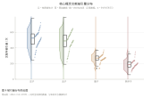<br><sub>图 6 · 被引量分布雨云图（原始数据+分布）</sub></td><td align="center" width="33%">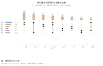<br><sub>图 7 · 概念集合交集 UpSet 图</sub></td></tr>
<tr><td align="center" width="33%">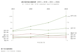<br><sub>图 8 · 十年发文量坡度图</sub></td><td align="center" width="33%">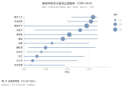<br><sub>图 19 · 敦煌学关键词主题趋势图</sub></td><td align="center" width="33%">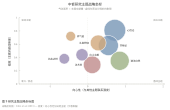<br><sub>图 9 · 研究主题战略坐标图</sub></td></tr>
<tr><td align="center" width="33%">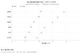<br><sub>图 10 · 篇均被引克利夫兰点图</sub></td><td align="center" width="33%">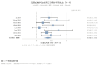<br><sub>图 11 · 干预效应元分析森林图</sub></td><td align="center" width="33%">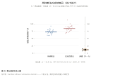<br><sub>图 12 · 教法差异估计图（bootstrap）</sub></td></tr>
<tr><td align="center" width="33%">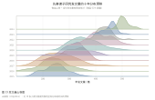<br><sub>图 13 · 十年发文量山脊图</sub></td><td align="center" width="33%">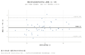<br><sub>图 14 · 评分员一致性 Bland-Altman 图</sub></td><td align="center" width="33%">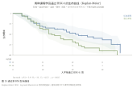<br><sub>图 15 · 通过 HSK4 的 KM 生存曲线</sub></td></tr>
<tr><td align="center" width="33%">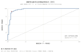<br><sub>图 16 · 续班判别 ROC 曲线</sub></td><td align="center" width="33%">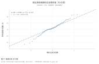<br><sub>图 17 · 成绩正态性 Q-Q 图</sub></td><td align="center" width="33%">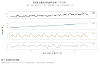<br><sub>图 18 · 月度发文量时序分解</sub></td></tr>
<tr><td align="center" width="33%">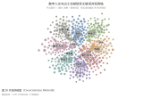<br><sub>图 20 · 数字人文关键词共现网络</sub></td><td align="center" width="33%">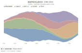<br><sub>图 21 · 敦煌学主题河流</sub></td><td align="center" width="33%">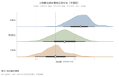<br><sub>图 21 · 后验分布半眼图</sub></td></tr>
<tr><td align="center" width="33%">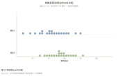<br><sub>图 22 · 预测得分分位点图</sub></td><td align="center" width="33%">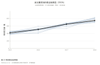<br><sub>图 23 · 发文量预测假设结果图 HOPs</sub></td><td align="center" width="33%">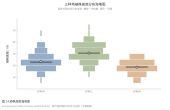<br><sub>图 24 · 植株高度分布海堆图</sub></td></tr>
<tr><td align="center" width="33%">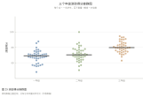<br><sub>图 25 · 测验得分蜂群图</sub></td><td align="center" width="33%">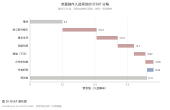<br><sub>图 26 · 稿件入选预测 SHAP 瀑布图</sub></td><td align="center" width="33%">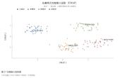<br><sub>图 27 · 文献嵌入投影图 UMAP</sub></td></tr>
<tr><td align="center" width="33%">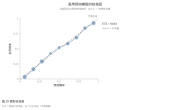<br><sub>图 28 · 预测模型校准图</sub></td><td align="center" width="33%">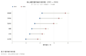<br><sub>图 29 · 篇均被引哑铃图</sub></td><td align="center" width="33%">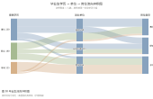<br><sub>图 30 · 毕业生流向冲积图</sub></td></tr>
<tr><td align="center" width="33%">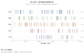<br><sub>图 31 · 核心词离散图</sub></td><td align="center" width="33%">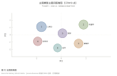<br><sub>图 32 · 主题间距离图 LDAvis</sub></td><td align="center" width="33%">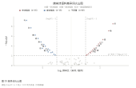<br><sub>图 33 · 唐宋诗语料差异词火山图</sub></td></tr>
<tr><td align="center" width="33%">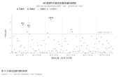<br><sub>图 34 · 《红楼梦》关键词显著性曼哈顿图</sub></td><td align="center" width="33%">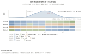<br><sub>图 35 · 文本效应稳健性多元宇宙图</sub></td><td align="center" width="33%">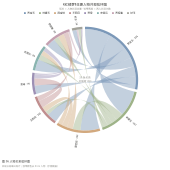<br><sub>图 36 · 《红楼梦》人物关系弦环图</sub></td></tr>
<tr><td align="center" width="33%">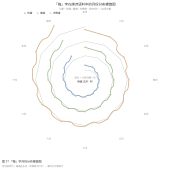<br><sub>图 37 · 「梅」字月份分布螺旋图</sub></td><td align="center" width="33%">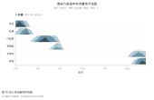<br><sub>图 38 · 唐宋诗人存诗量地平线图</sub></td><td align="center" width="33%">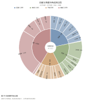<br><sub>图 39 · 四部分类藏书旭日图</sub></td></tr>
<tr><td align="center" width="33%"><br><sub>图 40 · 《红楼梦》人物共现弧线图</sub></td><td align="center" width="33%">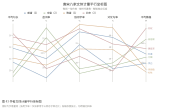<br><sub>图 41 · 唐宋作者文体计量平行坐标图</sub></td><td align="center" width="33%">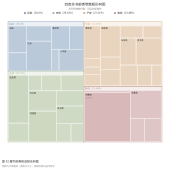<br><sub>图 42 · 四库全书部类卷数矩形树图</sub></td></tr>
<tr><td align="center" width="33%">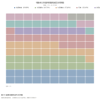<br><sub>图 43 · 《唐诗三百首》体裁构成华夫饼图</sub></td><td align="center" width="33%">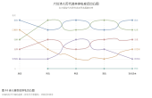<br><sub>图 44 · 六位诗人历代选本排名变迁凹凸图</sub></td><td align="center" width="33%">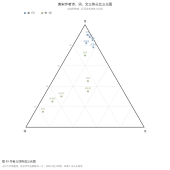<br><sub>图 45 · 唐宋作者诗、词、文三体占比三元图</sub></td></tr>
<tr><td align="center" width="33%">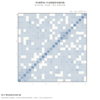<br><sub>图 46 · 《红楼梦》前 26 回母题复现递归图</sub></td><td align="center" width="33%">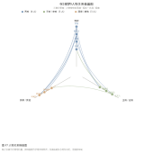<br><sub>图 47 · 《红楼梦》人物关系蜂巢图</sub></td></tr>
</table>

## 为什么造它

学术绘图工具断成两截：

| | 老派（Origin / matplotlib / Visio） | 新派（Figma / ECharts） |
|---|---|---|
| 严谨 | ✅ 矢量、字号规范、可投稿 | ❌ 导 PDF 是截图转位图 |
| 颜值 | ❌ 默认审美停在 2005 年 | ✅ 漂亮 |
| 上手 | ❌ 调一张图一下午 | ✅ 快 |

ScholarChart 站在断层中间：**把期刊规范做成默认值，把淡雅审美做成默认值**，两边都不用妥协。

## 特性

- **纯 SVG 原生渲染** —— 天生矢量，无限缩放无损
- **三种导出**：
  - `PDF · 矢量`：走浏览器打印管线（Chrome/Edge "另存为 PDF"），矢量路径 + 字体嵌入，可直接投稿
  - `SVG`：源文件级导出，可再编辑
  - `PNG`：最高 600 dpi 位图，满足期刊补充材料
- **期刊幅面预设**：单栏 85mm / 1.5 栏 130mm / 全栏 170mm / 全栏方形，毫米级物理坐标
- **学术图面惯例**：左下轴刺、向内刻度、发丝网格、图号图注（"图 1 ……"格式）、数据来源注
- **色盲安全淡雅配色**：基于 Okabe-Ito 色盲安全色系的低饱和柔化，4 套主题
- **零依赖**：无 npm 包、无构建步骤、无网络请求，`file://` 直开可用

## 图表类型

**经典六件套**

| 类型 | 场景 |
|---|---|
| 趋势图 | 多序列时间趋势、置信带、类目/数值轴 |
| 柱状图 | 分组对比、误差棒（±SD）、数值标注 |
| 热力图 | 共现矩阵、相关矩阵、斜排标签、色标 |
| 雷达图 | 多维方法/能力对比 |


**新一代统计图（第一批）**——近年统计绘图文献里取代老图型的现代方案：

| 类型 | 取代谁 | 出处 |
|---|---|---|
| 雨云图 | 柱状图 + 误差线 | Allen et al. 2019：半小提琴（分布）+ 原始散点（雨）+ 箱线（摘要统计）三合一 |
| UpSet 图 | 韦恩图（集合 > 3 时） | Lex et al. 2014, Nature Methods：交集矩阵 + 规模排序 |
| 坡度图 | 分组柱状图（前后对比） | Tufte：多时间点排名/数值流转，两端标签自动防叠 |
| 战略坐标图 | ——（文献计量专属） | Cobo et al. 2011：密度 × 向心性四象限定位研究主题，气泡 ∝ 文献量，标签防碰撞 |
| 点图 | 分组柱状图 | Cleveland & McGill 1984：位置编码感知精度 > 长度编码 |
| 主题趋势图 | ——（文献计量专属） | Biblioshiny Trend Topic：关键词年度跨度横线 + 峰值年圆点，圆点面积 ∝ 词频 |
| 共现网络图 | ——（文献计量专属） | VOSviewer 式：FR 力导向布局（网格加速）+ 标签传播社区着色，节点面积 ∝ 权重，仅标前 N 大节点，边极淡 |
| 主题河流图 | 堆叠面积图 | Biblioshiny Theme River：中心对称堆叠 + Catmull-Rom 平滑，图例独立成行不压图，河流宽窄 = 年度热度 |


**现代统计学图型（第二批）**——不换皮，真算法：

| 类型 | 干什么 | 统计内核 |
|---|---|---|
| 森林图 | 元分析合并效应 | 逆方差权重 + DerSimonian-Laird 随机效应 + Q / I² / τ² 异质性检验 |
| 估计图 | 两法/两组效应量 | Gardner-Altman 1986 + bootstrap B=3000 百分位 CI（估计统计运动） |
| 山脊图 | 分布随时间漂移 | 高斯核密度（Silverman 带宽）错层叠放 |
| 一致性图 | 两法测量比对 | Bland-Altman 1986, The Lancet：均值-差 + 95% 一致性界限 |
| 生存曲线 | 时间到事件 | Kaplan-Meier 1958 + Greenwood CI + Mantel-Cox log-rank + 风险表 |
| ROC 曲线 | 判别/诊断准确性 | 秩法 AUC（含并列平均秩）+ bootstrap CI + Youden J 最佳切点 |
| Q-Q 图 | 分布正态性检查 | Blom 校正经验分位数 vs Φ⁻¹（A&S 26.2.23），R qqline 法参考线 |
| 时序分解 | 趋势-季节-残差 | 经典加法分解（statsmodels decompose 呈现版），四联面板 |


**不确定性 · AI · 文本图型（第三批）**——2026-11 新增：

| 类型 | 干什么 | 出处 / 内核 |
|---|---|---|
| 半眼图 | 贝叶斯后验分布 | Kay ggdist：半密度 slab + 66%/95% 点区间 |
| 分位点图 | 分布的频率框架表达 | Kay et al.：等概率分位点，数点读概率 |
| 假设结果图 | 预测不确定性 | Hullman et al. HOPs：抽样帧 SMIL 轮播 + 中位轨迹 |
| 海堆图 | 大样本单变量分布 | 2024 Ecology and Evolution：竖直方图 + 均值/中位摘要 |
| 蜂群图 | 原始数据全量呈现 | 贪心防重叠排布，每点一样本 |
| SHAP 瀑布图 | 单个预测的特征归因 | Lundberg & Lee 2017：基线 + 逐项 SHAP 加减 |
| 嵌入投影图 | 文本/词向量聚类结构 | UMAP / t-SNE 二维投影散点 |
| 校准图 | 预测概率可靠性 | 分箱预测 vs 实际 + ECE 期望校准误差 |
| 哑铃图 | 两时点/两组对比 | 两点一线 + 差值标注 |
| 冲积图 | 类目多阶段流向 | 桑基类目版：贝塞尔流带，宽 ∝ 流量 |
| 词汇离散图 | 词在文本全程的位置分布 | 语料库语言学经典图型 |
| 主题距离图 | 主题模型结构总览 | Sievert & Shirley 2014 LDAvis：JS 距离 MDS 投影，气泡 ∝ 占比 |

**差异 · 扫描 · 稳健性 · 关系图型（第四批）**——2026-11 新增：

| 类型 | 干什么 | 出处 / 内核 |
|---|---|---|
| 火山图 | 两组差异分析总览 | 效应量 × −log₁₀ p：双阈值线 + 两翼着色 + top 条目标注 |
| 曼哈顿图 | 沿序列分段的显著性扫描 | 分段交替着色 + 显著线 + 最高峰标注（GWAS 经典图型） |
| 多元宇宙图 | 多重分析的稳健性检验 | Krähmer & Young 2026：估计密度面板 + 分箱决策仪表盘 |
| 弦环图 | 多对多关系总览 | Krzywinski et al. 2009 Circos：弧长 ∝ 总量，弦带 ∝ 关系强度 |

**周期 · 密度 · 层级 · 多维图型（第五批）**——2026-11 新增：

| 类型 | 干什么 | 出处 / 内核 |
|---|---|---|
| 螺旋图 | 周期时序绕环呈现 | 阿基米德基线螺旋 + 径向值偏移；2025-10 arXiv 时序图用户研究的实验图型 |
| 地平线图 | 多序列高密度时序 | 色带分层折叠（Few horizon graph）；数量级标度对应 Braun et al. IEEE TVCG《Reclaiming the Horizon》变体 |
| 旭日图 | 层级结构占比总览 | 同心环分段：角度 ∝ 量，逐层同系渐变编码深度 |
| 弧线图 | 一维布局上的关系连接 | 基线节点 + 贝塞尔弧：弧宽 ∝ 关系强度，弧高 ∝ 相隔距离 |
| 平行坐标图 | 多维个体画像对比 | Inselberg：每维独立标度折线 + 组别着色 + 末轴标签避让 |
| 矩形树图 | 两级层级占比 | squarified 布局：面积即份额 + 顶层着色 + 阈值内嵌标签 |
| 华夫饼图 | 构成占比（受众版） | 10×10 格阵：每格 1% + 取整微调保总和 |
| 凹凸图 | 多期排名变迁 | 名次连线 + null 断线 + 首末标签避让 |
| 三元图 | 三分量构成 | 重心坐标定位 + 三组等值网格 + 分组着色 |
| 递归图 | 母题复现与序列自相似 | 共享计数矩阵 / ε 阈值双模式点阵 + 点阵率图内标注 |
| 蜂巢图 | 分组网络（人物/机构关系） | 节点按身份钉在辐射轴上 + 向心弧线连关系，无随机布局 |

## 快速开始

```bash
git clone https://github.com/jyummy/scholarship.git
cd scholarship
# 方式一：直接双击 index.html（零依赖）
# 方式二：本地服务（推荐，样例数据全量加载）
python3 -m http.server 8000
```

或直接用在线版：<https://jyummy.github.io/scholarship/>（功能与本地版完全一致）。

右侧面板：选样例 → 改幅面/配色 → 编辑 JSON 数据 → 导出。

### 导出 PDF

点击 **PDF · 矢量**，在弹出的打印窗口选"另存为 PDF"（Chrome / Edge / Safari 均支持）。输出为矢量 PDF，文字可检索、字体已嵌入、页面尺寸精确到毫米。

## 数据格式

所有图表用同一 JSON 结构（`type` + `data` + `opts`）：

```jsonc
{
  "type": "trend",
  "data": {
    "x": { "categories": ["2015", "2016"], "label": "年份" },
    "y": { "label": "发文量 / 篇" },
    "series": [{ "name": "庄子", "values": [412, 438] }]
  },
  "opts": {
    "title": "主标题",
    "subtitle": "副标题",
    "figLabel": "图 1",           // 期刊图号
    "figTitle": "四子研究年度发文量",
    "note": "数据来源：……"
  }
}
```

各类型完整字段见 [`samples/`](samples/) 目录十七个样例，复制即可改。

## 学术规范清单

- [x] 矢量输出（PDF / SVG），投稿不降质
- [x] 毫米级物理尺寸（Nature 单栏 89mm / 双栏 183mm 均可微调 JSON 预设）
- [x] 色盲安全配色（Okabe-Ito 柔化系）
- [x] 图号 + 图注 + 数据来源注（期刊三件套）
- [x] 仅左/下轴刺的极简坐标（去箱线）
- [x] 误差棒支持（±SD / ±SE）

## 目录结构

```
scholarship/
├── index.html          # 应用外壳（唯一入口）
├── src/
│   ├── app.js          # 应用逻辑：切换/预设/编辑/导出
│   ├── export.js       # SVG / PNG / PDF 导出管线
│   ├── fallback.js     # file:// 直开兜底
│   ├── core/           # 坐标系、比例尺、配色、提示
│   └── charts/         # 十七个图表引擎（每个一个文件）
├── samples/            # 十八套样例数据（JSON）
└── assets/             # 截图
```

## License

MIT
